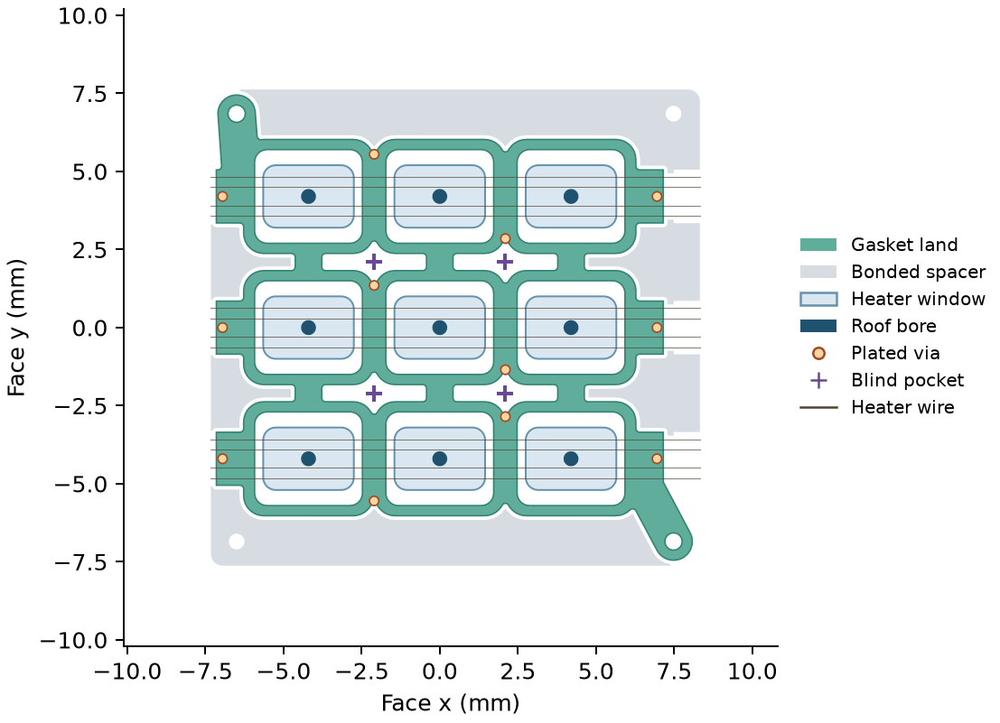

# Revision J chamber sealing and interpixel isolation

The released geometry closes nine distinct pneumatic cells. At the 60 kPa screening pressure the upper face imposes 0.703 N normal opening per cell. The delivered actuation records imply a maximum simultaneous 4.118 N across the nine face openings. The smaller internal port transmits the two investigated production pressure histories with at most 0.012 kPa calculated deviation from the single-pressure model. Maintaining that pressure also requires intact bonds and sufficiently small wire-flank gaps. An effective leakage conductance below **4.45 × 10⁻¹⁴ m³/(Pa·s) per cell** limits loss to 5% in the adverse 55 ms blocked-cell screen below. No measured Revision J tactile array pressure-decay or intercell response was present in the workspace. [Machine-readable results](seal-results.json) · [Current tactile array build](../../head/Owner-assembly.md)

## Pressure boundary from manufacturing data



The footprint shows the fabricated cut plane at the wire crossings. The smaller circles in the heater windows are gas ports through a separate upper sheet. The four crosses are enclosed blind pockets, each approximately 0.483 mm³. Nine pairs of lower and upper volumes communicate through nine dedicated ports. The continuous silicone, copper and FR-4 sheets span cells mechanically. An intact sheet contains no intercell gas plenum. The perimeter clearance is accessible to ambient through the wire exits. A leak into a blind pocket admits extra compliance; a second leak from that pocket can couple cells. Steel jig pins and the temporary pressing caul are removed after closure.

| Boundary | Independent DXF, Gerber and Excellon readback | Credible path when workmanship departs from the model |
|---|---|---|
| L10 gasket between L05 carrier and L11 PI | Nine internally closed openings. Horizontal and vertical intercell lands are 0.750 and 1.200 mm. Shortest distance from an opening to the gasket exterior, datum or blind pocket is 0.3247 mm. Two facing cut errors of 0.040 mm leave 0.2447 mm. Inserting a 0.020 mm synthetic slit between cells merges them. Cutting to the skirt vents one cell. | Microchannels along gasket/mask, gasket/PI, wire flanks or lifted contact-bar transitions. Cut bridges mechanically connect the gasket and enclose the four dead pockets. |
| Lower window and L01–04 floor | Nine carrier-board window outlines extracted from routed-profile centrelines match all three floor laminate cutouts to <0.00001 mm² per window. [The carrier windows are unplated internal routes.](../../head/Fabrication.md) Unperforated copper L01 spans all nine. The L04 window-to-outside adhesive land is ≥1.650 mm nominal. Min lower-window inset inside L10 opening is 0.275 mm. Subtracting 0.10 mm routed-edge allowance, 0.08 mm relative registration and 0.04 mm cut error leaves 0.055 mm. | An unbonded channel at the board/adhesive, adhesive/PI or PI/copper plane can connect adjacent cavities or a window to the edge. Opposed independent film offsets can produce unsupported lips; inspect actual overlap in backlight. A cracked copper floor, solder ridge, trapped fiber or creased bond defeats a purely planar test. |
| Copper tracks, board vias and holes | All twelve Ø0.300 mm via rims lie outside the gasket air domains (minimum 0.266 mm) and outside lower routed windows (0.741 mm). Neither solder-mask artwork opens on a bore; min mask-opening distances are 0.175 mm front, 0.910 mm back. All lie under L04. Ten Ø0.65 cable PTH rims are ≥2.25 mm from gas, four Ø0.55 datum rims ≥1.156 mm. All 48 nominal four-wire bar crossings lie over exposed 0.35 mm wide copper at the twelve pads. | The barrel itself is open. If a gasket-edge leak reaches an imperfect via tent, a disbonded floor-side adhesive can connect the barrel to atmosphere or another cell. Three left-side vias have only 0.200 mm nominal bottom adhesive coverage beyond the rims. A 0.08 mm placement, 0.04 mm edge, 0.05 mm drill-position and 0.04 mm increase in radius can exhaust that local coverage; these last two are scenarios. Confirm L04 covers those mouths during assembly. Gasket seating around the pad/mask height transition remains critical. |
| L11/L12/L13 paired bores and L14/L15 cap | Each upper adhesive/PI aperture is concentric with the larger copper opening. L14 and L15 contain congruent apertures of 10.1304 mm². The room-temperature acceptance dimensions Ø0.600 ±0.010, Ø0.425 ±0.010 mm and ≤0.025 mm eccentricity give ≥0.0525 mm dielectric overlap. The smaller accepted bore stays wholly inside the larger. | Smear or burr obstructs the individual port. Radial delamination in either cap bond can transfer pressure laterally; through-bond separation reaching a second cell couples their volumes. |
| L16 compliant face bond and L17 membrane | L16 opens 11.7180 mm² per cell. Adjacent bond webs are 0.510 mm across columns and 0.960 mm across rows. The closest opening is 1.255 mm from the sheet exterior. L17 has no cut hole over a cell. | First inspect the narrow horizontal bond webs for peeling, wrinkles and adhesive contamination. Loss of the face seal can couple cells even with a perfect gasket. A tear vents a cell. The diaphragm or common cap can also transmit mechanical motion to an adjacent site without a gas leak. |
| L06 retainers and L07–L09 spacers | The six coincident spacer pieces have 58.134 mm² of nominal installed area. Three L06 wire retainers occupy inactive outer exits. All four centerline lanes cross at least 0.750 mm of gasket on each shared column divider and about 1.22 mm on an outer wire exit. | Parts of the external skirt are open by design. A gap across a ring can join that skirt. Loose wire tails, conductive debris and trapped dust at the ring can defeat the local seal. |

The qualified lower-window inset and the remaining gasket web measure separate features. A common translation of the gasket preserves the web between its own contours. Relative translation can move the web off its board support. At ±0.20 mm ordinary routing tolerance the stack-up allows a 0.045 mm incursion into the intended land. The narrower ±0.10 mm drawing tolerance and inspection of actual routed windows apply to the stated closed geometry. [Carrier routing check](../../head/carrier/routing-tolerance.json) · [Independent manufacturing data reader](geometry_check.py)

## Normal opening, preload and bond traction

The broadest possible sealed face span in the present cut is the 11.7180 mm² L16 opening. Face normal demand is the common-time sum of gauge pressures times this area. The 10.2094 mm² gasket opening and 5.6594 mm² lower floor define two other free bodies. Adding their opening loads would count internal reactions twice. The owner's projected tactile force uses the 10.1304 mm² cap window.

| Blocked rigid-volume model or imposed load | Sum of simultaneous site pressures, kPa | Upper face, N | Gasket plane, N | Floor plane, N | Mean spacer traction at 0.20 MPa assumed gasket pressure, MPa |
|---|---:|---:|---:|---:|---:|
| Largest of 42 emitted-waveform schedules, four wires, all nine, 750 °C ceiling | 351.43 | 4.118 | 3.588 | 1.989 | 0.273 |
| Largest of the modeled ideal 450 °C families, all nine | 289.58 | 3.393 | 2.956 | 1.639 | 0.260 |
| Largest of the modeled ideal 750 °C families, all nine | 489.53 | 5.736 | 4.998 | 2.770 | 0.301 |
| All nine simultaneously at an imposed 60 kPa each | 540.00 | 6.328 | 5.513 | 3.056 | 0.311 |

The six spacer bonds carry gasket compression after caul removal. Assuming they alone carry the preload and assigning the largest hydraulic free-body area to their tensile reaction gives mean demand `(q Ag + Fface)/As`, where `Ag = 58.750 mm²` and `As = 58.134 mm²`. A gasket mean contact pressure `q = 0.05, 0.20, 0.50 MPa` gives 0.159, 0.311 or 0.614 MPa spacer stress in the 9 × 60 kPa case. Hydrostatic pressure can invade a connected, weakly loaded contact wherever local normal compression falls below gas pressure. Thus a 50 kPa *mean* gasket preload offers no 60 kPa local closing margin. Even 200 kPa mean cannot establish the minimum stress near an ENIG edge. Peel, creep at temperature, board/foil flexure and reaction concentrations increase local demand. Full-area mean stress is a load estimate, not a material allowable.

The selected plain 35A silicone has nominal flat compression 14.0%; the accepted gasket/installed-gap limits span 3.69–18.56%. The 35 µm electrode step and 31.6 µm wire give 40.2% nominal local geometric compression at the crown. Rubber deformation around a cylindrical flank and mask ridge controls interfacial contact and the remaining flow gap. Shore hardness or crown interference cannot determine retained force after adhesive relaxation. The 467MP manufacturer's 90° peel data vary from 5.4 to 10 N/cm on stainless steel with dwell, and 7 N/cm on aluminum after 72 h. The 9731 silicone-side 180° peel example on silicone rubber is 6.1 N/cm at 23 °C after 72 h. These fixtures measure line peel under imposed displacement. Hot through-thickness traction and cyclic edge-peel resistance on the actual PI/FR-4/soldermask/silicone stack remain unmeasured. [3M 467MP](https://multimedia.3m.com/mws/media/1561530O/3m-adhesive-transfer-tape-467mp.pdf) · [3M 9731](https://multimedia.3m.com/mws/media/2366081O/3m-double-coated-tape-9731.pdf)

## Pressure loss and inactive-neighbor pressure

Define conductance `G` in m³/(Pa·s) with volumetric flow referred to 25 °C and one atmosphere. For an isothermal continuum slit of width `b`, height `h` and length `L`, `G = b h³/(12 μ L)`. Widths in parallel add. With absolute pressures `P1,P2`, the compressible flow at reference pressure `P0` is `Q0 = G (P1² − P2²)/(2P0)`. Air viscosity is 18.5 µPa·s. For a single rigid cavity, `C dp/dt = −Q0` where `p` is gauge pressure. The room-temperature slow-test capacitance is `V/P0`. The more adverse hot-pulse calculation uses `C = V/[γ P0 (Th/T0)]`, with `γ = 1.4`, `V = 13.8833 mm³`, `T0 = 298.15 K` and `Th = 474.7 K`, the isochoric temperature corresponding to +60 kPa. This freezes the initial adiabatic derivative throughout the decay and assumes room-temperature leak-path viscosity. The actual gas cools as it expands. A moving diaphragm adds volume compliance. The volume, absolute temperature and boundary stiffness of a plugged pressure-test line must be accounted for separately.

For `x = exp(−Gt/C)` and `β = p_initial/(2P0)`, the remaining pressure fraction is `x/[1 + β(1−x)]`. Two equal blocked cavities with one divider leak, initially at `p_initial` and zero gauge, conserve their summed pressure in the constant-capacitance model. The pressure fraction gained by the idle cavity is `[1−exp(−2G(1+β)t/C)]/2`. The largest hot sensitivity uses equal low capacitance on both sides; a cool receiver ordinarily has more pneumatic capacitance. Models with atmosphere on every leakage exit maximize driving pressure on the charged cell; a finite unvented skirt or back-pressured neighbor reduces that loss. Multiple simultaneously active neighbors can cumulatively pressurize one idle site. To bound such cross-talk, bound the **sum** of conductances incident on each idle site as well as each driven site's total outgoing conductance.

| Equivalent residual height | Total pressure lost to ambient in 20 ms | Total lost to ambient in 55 ms | Initial pressure gained by one idle neighbor in 55 ms |
|---|---:|---:|---:|
| 1 µm | 0.49% | 1.35–2.15% | 0.25–0.40% |
| 2 µm | 3.87% | 10.22–13.04% | 1.96–2.53% |
| 3 µm | 12.37% | 29.88–34.51% | 6.30–7.46% |
| 5 µm | 44.30% | 77.96–81.35% | 23.20–25.14% |

The exterior case assumes 16 continuous 40 µm-wide flank channels: two heater exits, four wires and two flanks each. A common adverse length of 0.245 mm tests an eroded or oblique path. An intact horizontal wire-crossed web actually presents ≥0.670 mm after two edge errors. The neighbor case assigns eight flanks to that single web. Width 40 µm has the scale of the 31.6 µm wire; actual cusp shape and rubber conformity are unknown. The lower number uses no slip, the upper adds a first-order slip multiplier `1 + 6λ/h` with an effective 0.10 µm slip length. The 20 ms column uses no slip. These are idealized continuous rectangular apertures, with the constant maximum pressure applied initially, and not metrology of built gaps. Sidewall resistance, tortuosity and short constrictions lower flow; a wider delamination, contamination, eccentric masking or larger slip increases it. A single 0.50 mm wide, 3 µm tall, 0.245 mm long adhesive seam produces 24.4–28.4% loss in 55 ms. At 5 µm it gives 69.9–73.7%. No CAD-only lower bound on delivered cell pressure survives a full-through seal failure. [All 1–55 ms, 5–60 kPa cases](seal-results.json)


Holding loss below 5% for the full hot 55 ms case requires `G_total ≤ 4.45 × 10⁻¹⁴ m³/(Pa·s)`. With the illustrative 16-flank geometry, this corresponds to an equal gap of 1.56 µm with no slip or 1.38 µm with the slip sensitivity. At a cold test pressure of 5 kPa the same conductance corresponds to 0.228 µL/s (13.7 µL/min) of reference flow and, for the bare blocked chamber, a small-signal isothermal time constant ≥3.08 s. The exact cold 5 kPa pressure remaining after 55 ms is ≥98.18%. At a blocked initial 60 kPa, the ambient-equivalent flow limit is 3.46 µL/s. These percentages are a chosen engineering allowance for the issued 55 ms observation, not inferred leakage or a lifetime criterion. They put a quantitative limit on the change to the published rigid sealed pressure proxy; diaphragm displacement, heat-transfer error, supports warming and loaded contact affect pressure and force separately.

Bulk permeation is comparatively small on this timescale. The Parker handbook reports room-temperature silicone air permeability 18.0–25.6 × 10⁻⁸ std cm³·cm/(cm²·s·bar) from Dow Corning. Assigning the upper value to the 0.254 mm diaphragm and every gasket sidewall at the minimum 0.245 mm path gives about 1.61 × 10⁻¹⁷ m³/(Pa·s) at the chosen flow reference. At the cited 200 °C coefficient, 74 × 10⁻⁸, the corresponding value is 4.66 × 10⁻¹⁷. These steady-state homogeneous-material estimates are orders of magnitude below the interface flow budget. The purchased material lot, temperature history and adhesive permeability are uncharacterized. [Parker O-Ring Handbook, Table 3-24](https://www.parker.com/content/dam/Parker-com/Literature/O-Ring-Division-Literature/ORD-5700.pdf?BtThxW=gAjJMV)

## Equalization across the smaller upper port

From the emitted cut areas and four-wire displacement, the lower and upper effective volumes are 7.575 and 6.308 mm³. Half the neck volume was assigned to each. The cylindrical sections in series are 0.425 mm diameter × 0.0838 mm in L11/L12 and 0.600 mm × 0.127 mm in L13. For volume flow `Q`, the lumped model uses `Δp = M dQ/dt + R Q + B Q|Q|`. Here `M = ρ Σ[(l+er)/A]` accounts for local air inertia, with effective end-length factor `e = 0.60–1.70` per section to screen open ends and the internal step. The nominal factor is 0.85. `R = (8μ/π)Σ(l/r⁴) + 3μ/r_min³` adds developed tube and thin-hole entrance viscous resistance. The quadratic coefficient `B = ρ/(2 Cd² A_min²)` uses an effective discharge coefficient `Cd = 0.55–0.80` to screen separated flow. These combined coefficients are engineering sensitivities for the stepped geometry. A fourth run evaluates the real part of cylindrical oscillatory wall impedance at the acoustic frequency and holds it as a higher drag sensitivity. Air density is 1.184 kg/m³. [Short cylindrical-orifice acoustic impedance](https://arxiv.org/abs/2001.04904) · [Measured nonlinear microperforate impedance](https://research.tue.nl/en/publications/non-linear-acoustic-transfer-impedance-of-micro-perforated-plates/)

Assigning the heat source entirely to the lower cavity drives the pressure difference `dΔp/dt = (1+Vu/Vl) dp̄/dt − Q(1/Cl+1/Cu)`, with `Ci = Vi/(γP0)`. Then `p_upper = p̄ − Vl Δp/(Vl+Vu)`. The imposed `p̄(t)` is the rigid-chamber pressure calculated from the source study. The nominal acoustic frequency is 16.56 kHz, and the screened range is 12.63–18.77 kHz (quarter periods 13.3–19.8 µs). The small-signal amplitude damping time at nominal conditions is 0.90 ms. A quarter period marks initial pressure exchange and does not establish settling. Nonlinear drag increases damping at finite flow. Constant ambient properties and a rigid diaphragm are suitable for this sensitivity calculation; edge geometry, thermal boundary layers and membrane compliance change actual impedance.

| Source forcing | Largest computed upper pressure deviation from the supplied one-pressure history over all cases |
|---|---:|
| Equal-power 2-, 3-, 4-wire thermal records | 0.0024 kPa, ≤0.021% of source peak |
| Actual production four-wire P22, 450 °C ceiling | 0.0053 kPa, 0.031% |
| Actual production four-wire P22, 750 °C ceiling | 0.0116 kPa, 0.031% |
| Imposed smooth 60 kPa pressure rise over 15, 5, 1 ms | 0.0070, 0.0483, 1.061 kPa |
| Imposed smooth 5 kPa pressure rise over 0.080 ms | 1.220 kPa, 24.4% |

The production rows drive a separate port model with the recorded pressure from a numerical replay of actual switch edges. The 80 µs stress imposes a *fluid* pressure rise on the electrical switching timescale. It demonstrates a failure of instantaneous equilibration for a sufficiently fast fluid source. On the thermal pulse records the pressure rise is much slower. Pressure equality between surviving subvolumes and uniform temperature within each subvolume are distinct approximations: rapid pressure transmission cannot establish the gas temperature distribution against the walls. Adhesive intrusion, bore blockage, compliant diaphragm motion and cross-pixel leaks change the applicable model. [Production pressure histories](../../supplement/controlled-gas.json) · [Equal-power pulse histories](../../supplement/equal-power.json)

## Evidence needed from a built tactile array

The workspace search identified the empty pressure and calibration templates in TPP_Compact_3x3/head/leak, the synthetic demo in TPP_Parallel_3x3/analysis/leak_test.py, the numerical TPP_Revision_D/analysis/SEALING_ANALYSIS.md and earlier prototype/control references in KaistTelerobotics.md. None contains a Revision J nine-cell measured decay, channel-to-channel pressure map, hot preload or aged bond result. For a first build, a sacrificial instrumented floor gives reversible pneumatic access on that test article without adding permanent ports to the issued design. Block membrane motion, apply pressure with the driver off, and close the supply. Start at a modest pressure, then include the intended maximum because a peel path may open only above threshold. Measure each site's decay and the response of quiet neighbors, rotating the charged site through all nine. A single steady decay cannot separate leakage from thermally relaxing gas, diaphragm creep or fixture leak.

Use a settled isothermal charge, subtract blank fixture leakage, and measure total installed pneumatic storage `C_test` from a known volume displacement or calibrated fill. Fit the compressible decay expression above with `C_test`, or reduce the measured ambient-referenced flows. Compare tactile array-only aggregate and pairwise conductances with the stated budget. Repeat the same check following the optional foil bridge operation and after representative warm cycles. Instrument lines can have much greater volume than the 13.9 µL tactile array. Using the bare-tactile array 3.08 s figure directly on such a fixture would overestimate seal quality. Without calibrated pressure access, optical displacement of neighbors under controlled single-cell drive can screen gross cross-talk, while retaining ambiguity from shared-sheet motion. [Assembly and post-bridge checks](../../head/Owner-assembly.md)

Reproduce from the repository root with the scientific Python environment:

```sh
python analysis/seal/pressure_seal.py
python analysis/seal/plot_seal.py
```
