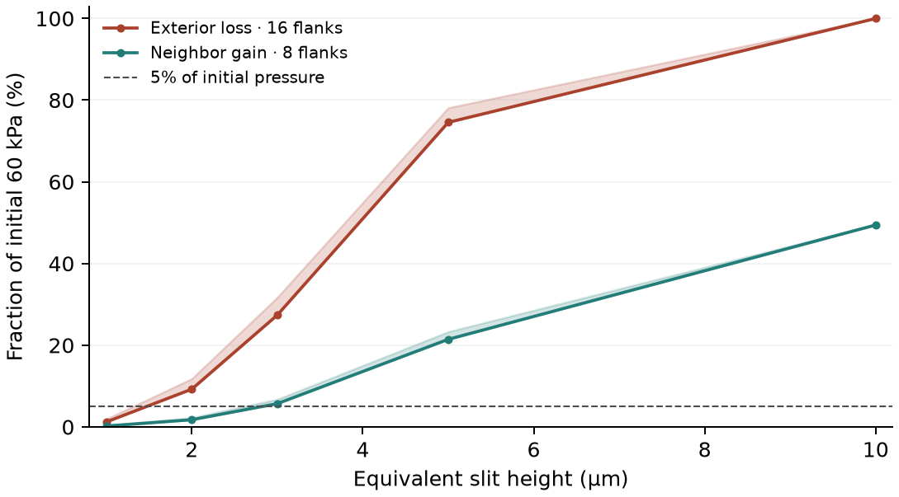

# Screw seating, heater clearance and pressure isolation

**All nine nominal four-wire cells close in the exported assembly.** Subtracting the actual STEP solids from nine independent test boxes gives 15.457328 mm³ of gas per cell with the diaphragm initially flat. The nominal cold distance from the top of each straight NiCr wire to the lower face of the polyimide liner is 0.4834 mm. Under the hot-wire and assembly assumptions below, the remaining clearance is **0.052 mm at 750 °C**, or **0.024 mm** if the restraint locations move to the far edges of the contact lands. The dry stack is held between machined stops by four screws. Installed leakage, contact preload and actual thermal deflection have yet to be measured. [Reopened solids and seating results](step-readback.json) · [Cut-file and pneumatic results](seal-results.json)

## Fasteners, stops and dry interfaces

| Feature | Result from the released manufacturing data |
|---|---|
| Registration | All seven cut sheet profiles, the carrier, the cap and the winding base share four Ø1.400 mm holes. Centers are at the Cartesian combinations of x = −6.30, +7.28 and y = ±6.65 mm. Each screw rim clears the nearest contact-gasket opening by at least 0.458 mm in the nominal layout, measured from the edge of the **clearance hole**. |
| Three stop heights | The L01 backing seats the underside of L04 at z = −0.8000 mm, L09 at +0.7024 mm and L11 at +1.3274 mm. Each has four separate supporting pads. Their total nominal areas are 3.12, 3.00 and 3.00 mm². At the center and near each corner of all twelve pads, a point 0.5 µm below the seat lies in the backing, and a point 0.5 µm above it lies in the intended upper component. |
| Screw purchase | The four actual head seats contact the Ø1.80 × 0.50 mm heads. The M1.2 × 4 screws have 2.6924 mm nominal grip and 1.3076 mm engagement envelope in the aluminum backing, equivalent to 5.23 pitches at 0.25 mm pitch. Thread entry/run-out affects the number of fully developed threads. Nominal clearance from the tip to the back face is 0.6924 mm. The head top sits 0.080 mm below its local island. The actual screw solid intersects no other solid by positive volume in the assembly's smooth thread-envelope representation. [NBK screw drawing](https://www.nbk1560.com/en/products/specialscrew/nedzicom/miniaturescrew/SNZ-TZB/SNZ-M1.2-TZB/SNZ-M1.2-4-TZB/) |
| Field geometry | The active stainless grid is 0.350 mm thick. Its top is 0.321 mm above the relaxed diaphragm over an aperture, with the sheet compressed from 0.254 to 0.225 mm on its lands. All nine rear L01 windows end at the **continuous 0.127 mm L02 copper floor**. The complete structural body excluding heat tabs is 17.80 × 17.00 × 5.2724 mm. The bearing ears and screw islands contribute to its envelope. |
| Dry clamping | L03 floor silicone goes from 0.254 to 0.218 mm nominal thickness, L06 contact silicone from 0.600 to 0.550 mm, and L10 from 0.254 to 0.225 mm on the grid lands. These correspond to 14.2%, 8.33% and 11.4% nominal squeeze. At a 35 µm bar and 31.6 µm wire the L06 local geometric squeeze is 19.4%. Actual force depends on rubber response, surface height and plate flexure. |

Gauge the dry PI/copper pair while its ports remain visible. The nominal radial dielectric lip is 0.0875 mm. The two diameter limits and a measured center offset ≤0.025 mm give ≥0.0525 mm lip. Two independently displaced Ø1.40 sheets on M1.2 screws could shift by 0.20 mm relative to one another, sufficient to remove the lip. The close temporary registration and tab-root clips hold the inspected pair during screw installation. External witness marks reveal a subsequent lateral shift when the bore can no longer be seen through the closed stack. Diagonal seating against the hard pads sets nominal thickness. Head torque alone cannot establish the preload on the internal webs. The lower spreader contacts the backing. Check isolation from all heater taps and the intended state of the upper spreader after seating and forming the optional joint. [Assembly sequence](../../head/Owner-assembly.md)

## Wire and liner clearance at temperature

Take a straight wire anchored at positions separated by chord length *L*. If its available hot length is *S*, an apex displacement *h* requires at least two straight segments of total length 2√[(L/2)² + h²]. Thus **h ≤ ½√(S² − L²)** for any bow direction. This length bound permits an upward buckle without assuming that winding tension or sliding friction persists when hot. The lower PCB window is 2.90 mm long. A heater can lift off its shoulders, so the principal calculation uses the full **4.20 mm bar pitch**. A second calculation uses the two far edges of the 0.35 mm lands, giving 4.55 mm.

Set *S* = (*L* + 0.010 mm)[1 + α(*T* − 25 °C)]. The 10 µm is a bound on **excess centerline length trapped at closure**, distinct from the much larger bow that length could accommodate. The wire should remain straight and lightly tensioned on its guides through seating. The calculation assigns the entire retained length its maximum temperature. The actual axial model has cooler supported ends. Kanthal gives a mean expansion coefficient of 16.0 µm/(m·K) to 750 °C for its NiCr80 wire. Using 17.2 µm/(m·K), its 20–1000 °C value, allows additional expansion in this sensitivity calculation. The value for the purchased wire lot is unmeasured. [Kanthal NiCr80 wire data](https://prodshop.kanthal.com/en/products/datasheets/material-datasheets/wire/resistance-heating-wire-and-resistance-wire/nikrothal-80/)

| Maximum intact-wire temperature | Upper bound on bow, 4.20 mm chord | Remaining clearance, 4.20 mm chord | Remaining clearance, 4.55 mm chord |
|---|---:|---:|---:|
| 25 °C | 0.1450 mm | 0.2710 mm | 0.2651 mm |
| 450 °C | 0.2933 mm | 0.1224 mm | 0.1010 mm |
| 600 °C | 0.3303 mm | 0.0854 mm | 0.0616 mm |
| 750 °C | 0.3636 mm | 0.0520 mm | 0.0241 mm |

These columns subtract a 0.040 mm maximum land, 0.034 mm maximum wire diameter with its thermal expansion, and **0.050 mm combined inward motion of the assembled roof and liner** from the 0.540 mm minimum local hard gap. They also subtract the wire bow. At 750 °C, loss of the residual margin would require more than 0.0287 mm trapped cold excess on the 4.20 mm chord, or 0.0183 mm on the 4.55 mm chord, with all other adverse assumptions held fixed. A double-back, trapped foreign particle, slipping pickup that imports slack from another span, unusually hot failed wire or heavily indented roof falls outside this clearance calculation. [Wire-length calculation](wire_clearance.py)

The 25.4 µm dry PI lies against 0.127 mm copper except at the small gas port. Positive pressure below the film tends to support it against that metal. During the two four-wire center-pixel pulse replays the separate stepped-port model finds less than 0.0082 kPa between the lower and upper gas volumes. As a deflection scale, a freely spanning radius-1.725 mm circular PI plate, modulus 2.0 GPa and Poisson ratio 0.34, deflects about 0.045 mm per kPa with clamped edges in linear plate theory. Releasing edge rotation gives about 0.179 mm per kPa. At 0.0082 kPa even the latter gives about 1.5 µm. This comparison assumes the dry interface communicates with the upper gas and uses the small-pressure regime. Trapped air, thermal wrinkles, assembly flatness and external handling determine the actual total inward excursion. The explicit 0.050 mm budget covers those effects collectively. The rear floor, spanning the small backing window, is much stiffer. At 60 kPa, the same calculation on a circumscribed 1.76 mm-radius C110 disk gives 0.4–1.6 µm center deflection between clamped and simply supported cases. [DuPont PI properties](https://www.dupont.com/content/dam/dupont/amer/us/en/ei-transformation/public/documents/en/EI-10142_Kapton-Summary-of-Properties.pdf) · [C110 elastic properties](https://alloys.copper.org/alloy/C11000)

## Cell boundaries and pressure loading


At each site the L03 and L04 windows enclose 5.6594 mm² of floor, the L06 opening 10.2094 mm², and the L09 cap window 10.1304 mm². Each lower volume communicates only with its own upper volume through the Ø0.425 mm PI and Ø0.600 mm copper bores. L10 spans the upper opening. L11 bears on the surrounding sheet and has a wider 11.7180 mm² aperture. With the diaphragm seated on the cap, the exposed gas area is **10.1304 mm²**. Local lift from the cap could extend the pressure footprint toward the grid opening. Neither area predicts the contact force on a fingertip without the diaphragm and external load.

The analytic sum of cut area × installed height, less straight-wire displacement, yields gross 15.46814 mm³ and net volumes of **15.46274, 15.46003 and 15.45733 mm³** for two, three and four wires. Independently, cutting the complete four-wire STEP out of boxes whose boundaries pass through the intercell webs yields one closed gas component wholly inside each box. All nine components extend from z = −1.0180 to +1.1024 mm and have 15.457328 mm³ volume each. The two- and three-wire center volumes agree with the cut-profile calculation to within 0.000003 mm³. Four separate blind pockets at (±2.1, ±2.1) are approximately 1.224 mm³ each. A single breached web can admit one pocket as extra storage. Two breaches can connect neighboring cells through a pocket.

The L06 ring has 0.325 mm minimum to a non-cell boundary and at least 0.750/1.200 mm between horizontal/vertical neighbors. Two adverse 0.040 mm cut edges leave 0.245 mm of the minimum web. The lower window fits inside the upper gasket opening by 0.275 mm nominal, leaving 0.055 mm after the 0.10 mm routed-edge, 0.08 mm relative assembly and 0.04 mm gasket profile allowances. There are 48 four-wire/copper-bar crossings. All 12 Ø0.30 mm plated via bores lie outside the active gas openings (nearest rim 0.266 mm) and away from the lower routed windows. L03 covers their back mouths nominally, with only 0.20 mm cover at three left-side vias. Actual sealing is sensitive to conformity where wires cross the gasket and to seating of the dry floor, cap and diaphragm lands. Artificially cutting a 0.020 mm slit through one CAD web connects the adjacent cells, while cutting to the skirt vents one cell.

| Blocked-volume case | Same-time sum of gauge pressures | L09 seated face opening load | L06 opening load | L02 floor opening load |
|---|---:|---:|---:|---:|
| Largest of 42 emitted-controller cases | 345.52 kPa | 3.500 N | 3.528 N | 1.956 N |
| Largest ideal 750 °C schedule | 483.29 kPa | 4.896 N | 4.934 N | 2.735 N |
| Imposed 60 kPa at all 9 sites | 540.00 kPa | 5.470 N | 5.513 N | 3.056 N |

Each row gives forces on separate free bodies. At 9 × 60 kPa the hydraulic face demand alone averages 1.37 N per screw if shared equally. A lift reaching all L11 opening edges would increase that sum to 6.328 N. The initial gasket or diaphragm squeeze also loads the fasteners. For scale, assigning an illustrative 0.20 MPa mean pressure to 63.39 mm² of L06 rubber, 180.49 mm² of L03 rubber or 125.39 mm² of L10-to-grid contact gives 12.68, 36.10 or 25.08 N respectively. Each plane has its own load path through the three shelf levels. Neither adding the three figures nor assigning equal screw reactions gives a measured clamp force. A spring/plate solution would require the stock compression curves, actual flatness, bolt preload and contact distribution.

## Pulse transmission and leakage

The two-volume port model assigns half the neck volume to each side, giving **11.3854/4.0719 mm³** lower/upper. It uses a series inertance for both short cylindrical sections including end effects, viscous and entrance resistance, and an amplitude-dependent pressure loss. Effective inertial end lengths from 0.60 to 1.70 radius and discharge coefficients of 0.55–0.80 span the bore and loss sensitivities. Pressure-capacitance is V/(γP₀), with γ = 1.4. Nominal acoustic frequency is **19.0 kHz**, with 14.1–21.9 kHz across the selected cases. Applied to the actual four-wire P22 thermal replay histories, the maximum upper-compartment departure from the previous single-pressure history is **0.0029 kPa at the 450 °C setting and 0.0060 kPa at 750 °C**. The time for pressure transmission through a clear port is short compared with the 13–14 ms gas-pressure rise. The associated gas temperatures can still be nonuniform. [Short-port impedance](https://arxiv.org/abs/2001.04904) · [Nonlinear microperforation measurements](https://research.tue.nl/en/publications/non-linear-acoustic-transfer-impedance-of-micro-perforated-plates/) · [Numerical port model](pressure_seal.py)



For reference-volume flow at 25 °C and one atmosphere, a long shallow channel of width *b*, residual height *h* and length *L* contributes conductance *G* = *bh³*/(12µ*L*). The compressible flow is *G*(P₁²−P₂²)/(2P₀) for absolute pressures P₁, P₂ and reference P₀. The exterior calculation assigns 16 flank channels, each 40 µm wide and 0.245 mm long. A shared horizontal divider uses eight channels of 0.670 mm length. For a hot blocked cell initially at 60 kPa gauge, the receiver model uses pneumatic capacitance V/[γP₀(T/T₀)] with T/T₀ = 1 + 60/101.325. At 55 ms, 1 µm and 3 µm residual gaps respectively lose about **1.2% and 27.4%** of initial pressure to ambient under the no-slip calculation. The inactive neighbor in the separate two-cell model gains about **0.22% and 5.70%**. The shaded intervals allow a 0.10 µm slip length. The residual gap describes a hypothetical leakage channel, not the diameter of the wire.

A chosen **5%** loss allowance under that 60 kPa, 55 ms screen corresponds to total *G* ≤ **4.95 × 10⁻¹⁴ m³/(Pa·s)** per cell, about 0.254 µL/s of reference flow at 5 kPa cold test pressure. It illustrates how to interpret future measurements. The sealed, fixed-volume pressure results assume sufficiently small leakage and restrained diaphragm motion. Dry interfaces, local screw loading, thermal gradients and membrane contact affect actual performance. No decay trace or spatial pressure map from a built Revision K unit was available. The owner can assess these properties on the assembled prototype.

From the repository root, the independent geometry and pneumatic calculations can be reproduced with the scientific/CAD Python environment:

```sh
python analysis/seal/step_chambers.py > analysis/seal/step-readback.json
python analysis/seal/pressure_seal.py
python analysis/seal/plot_seal.py
```
